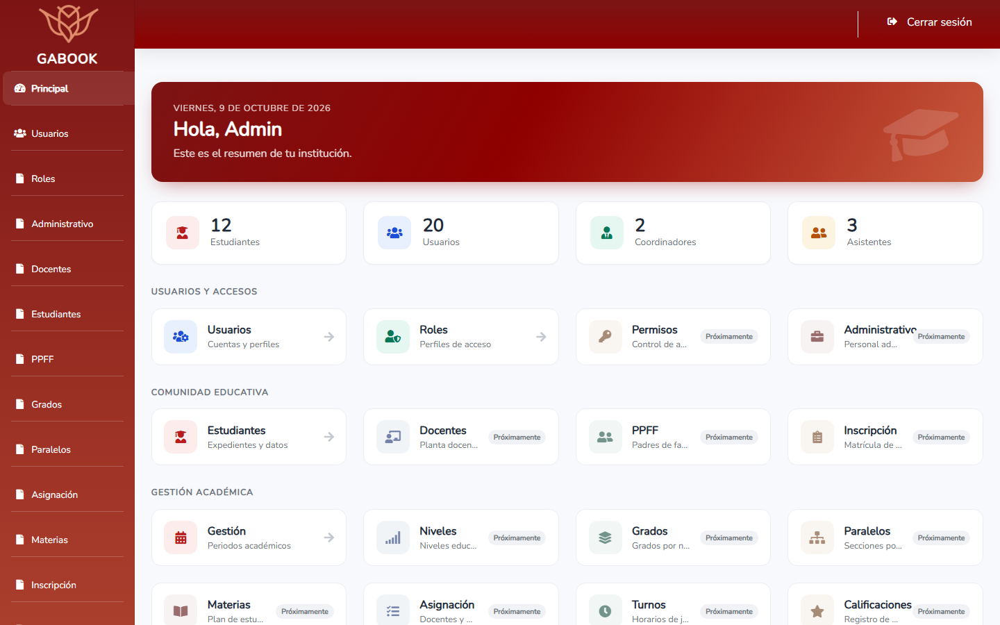
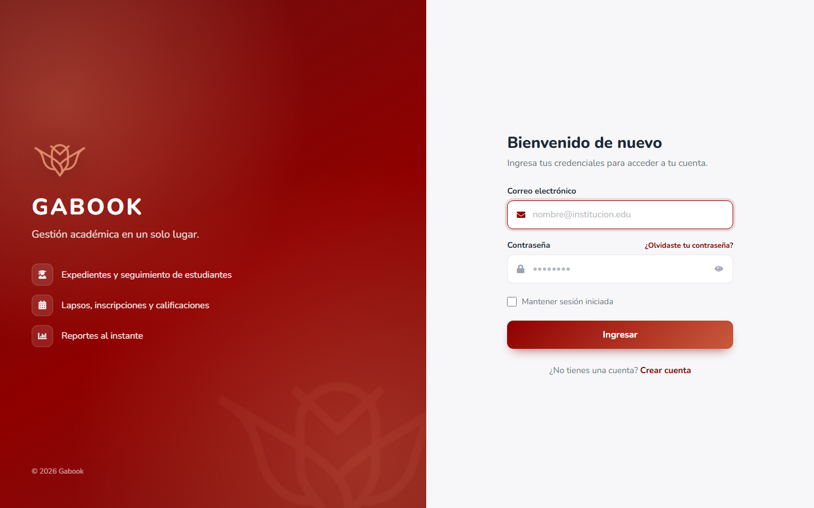
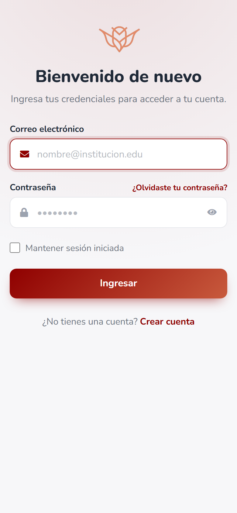
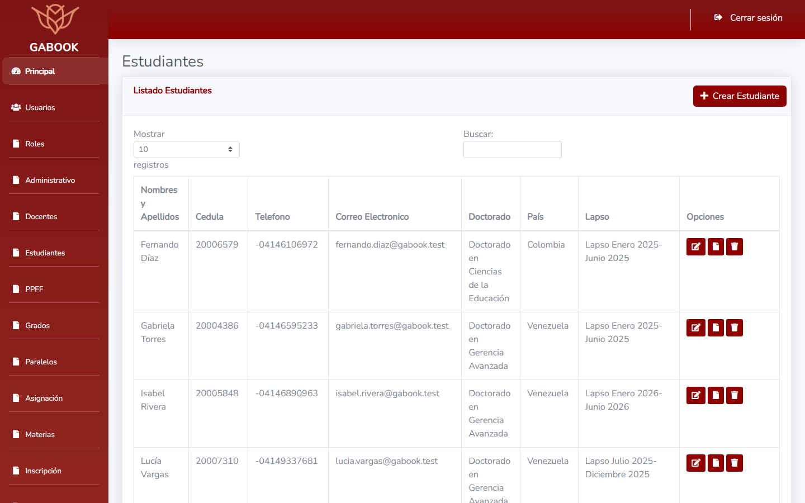
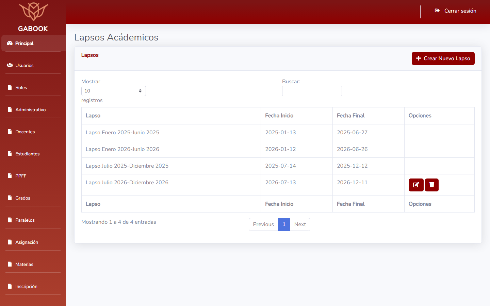
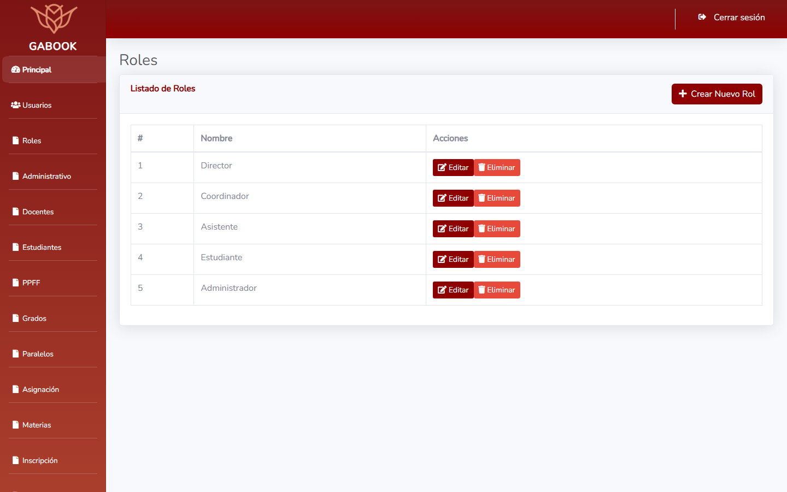
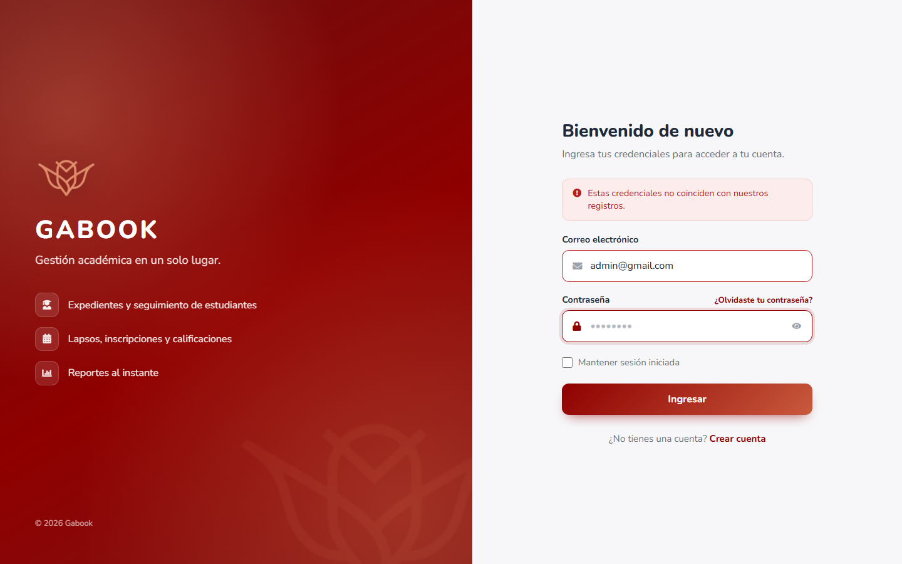

# Gabook — Sistema de Gestión Académica

Plataforma web para la administración académica de una institución educativa:
estudiantes, lapsos, inscripciones, calificaciones, usuarios y reportes, con
control de acceso por roles (Director, Coordinador, Asistente, Estudiante y
Administrador).

> **Nota de confidencialidad:** este sistema fue desarrollado para una
> institución educativa real. Por acuerdos de confidencialidad no se mencionan
> su nombre ni su información. Todos los datos que aparecen en este repositorio,
> en las capturas y en la demo (estudiantes, usuarios, calificaciones) son
> ficticios y se generaron solo con fines demostrativos.



## Capturas

| Inicio de sesión | Versión móvil |
|---|---|
|  |  |

| Estudiantes | Lapsos académicos |
|---|---|
|  |  |

| Roles | Validación de credenciales |
|---|---|
|  |  |

## Tecnologías

- **Backend:** Laravel 10, PHP 8.1, Laravel Sanctum, Spatie Laravel Permission
- **Frontend:** Vue 3, Blade, Bootstrap, Laravel Mix
- **Base de datos:** MySQL 8
- **Infraestructura:** Docker y Docker Compose

## Funcionalidades

- Panel principal con indicadores de la institución
- Gestión de usuarios y roles con permisos
- Expedientes de estudiantes e historial académico
- Lapsos académicos, inscripción por materias y registro de notas
- Reportes de estudiantes

## Mi aporte

- Migración progresiva de vistas Blade a Vue 3, con una API protegida por Sanctum
- Arquitectura por capas (Services, Repositories, Use Cases) en el módulo de roles
- Corrección del esquema de base de datos y del flujo de alta de estudiantes
- Rediseño de la interfaz: panel principal e inicio de sesión
- Entorno dockerizado y datos de prueba que se pueden recargar

## Estado

Proyecto en evolución. Los módulos de usuarios, roles, estudiantes, lapsos y
reportes están operativos. Grados, materias, pagos y otros módulos están en
desarrollo y aparecen como "Próximamente" en el panel.

## Ejecutar en local

Requisitos: Docker y Docker Compose.

```bash
cp .env.example .env
docker compose up -d --build
docker compose exec app php artisan migrate --seed
docker compose exec app php artisan db:seed --class='\DemoDataSeeder'
docker compose exec app npm run dev
```

Abrir http://localhost:8000

| Rol | Correo | Contraseña |
|---|---|---|
| Director (administrador) | `admin@gmail.com` | `12345678` |
| Coordinador | `luis.fernandez@gabook.test` | `password` |
| Estudiante | `maria.gonzalez@gabook.test` | `password` |

`DemoDataSeeder` se puede ejecutar varias veces: recrea los usuarios
`@gabook.test` con sus inscripciones y calificaciones.

Para ver los logs:

```bash
docker compose logs -f app
docker compose logs -f db
```
